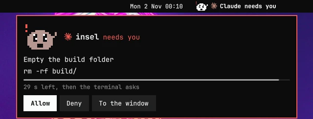
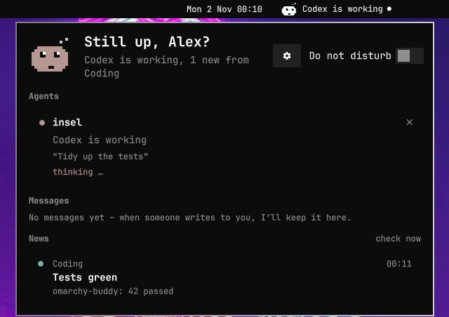
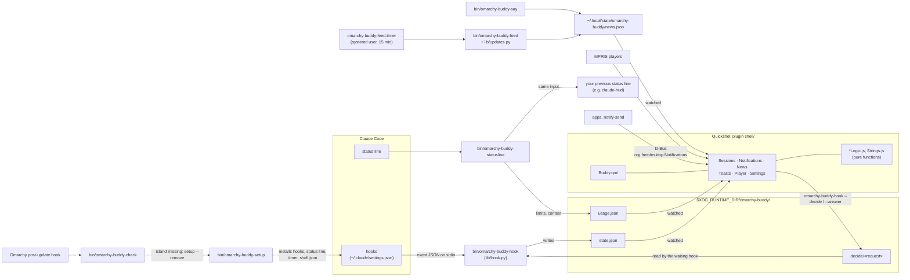

# Omarchy-Buddy

O-Morchy, a small pixel buddy in [Omarchy](https://omarchy.org)'s bar beside
the clock, with an island that opens under it like an Omarchy pop-up. It puts your Claude Code sessions (allow, deny, answer
questions, approve plans, jump to the terminal), news about your system and
every desktop notification (Beeper, Mailspring, Spotify, `notify-send` …) in
one place. Texts in English or German, following your system language or the
setting.

Inspired by [Coucou](https://github.com/Louis-CFM/coucou) for macOS and its
mascot Mochi – thank you! Omarchy-Buddy is a much smaller take on the idea for
Omarchy.

Version 1.2.0, see the [changelog](CHANGELOG.md).

Bar, peek, a request, the big view (demo data from `tests/looks`).

**In one sentence:** a Dynamic-Island-style pop-out for Omarchy/Hyprland,
built as a Quickshell plugin, that is your companion for Claude Code, the
desktop's only notification server, a news feed, a music player and an update
checker.

Overview: [Features](#features) · [Architecture](#architecture) ·
[How the parts fit together](#how-the-parts-fit-together) ·
[Security and privacy](#security-and-privacy) · [Install](#install) ·
[Settings](#settings) · [Troubleshooting](#troubleshooting) ·
[Development and tests](#development)

## Features

- **Claude Code in the island**: allow, always allow or deny permission
  requests, answer AskUserQuestion, approve or revise plans, jump to the
  session's terminal (also Orca panes). A countdown hands the request back to
  the terminal if you don't answer.
- **Codex too**: Codex CLI sessions show up like Claude's (state, ticker,
  done pop-up, allow or deny its permission requests), with Codex's mark.
- **Gemini CLI, Crush, Grok, Cursor CLI and GitHub Copilot CLI**: state,
  ticker, done pop-up and "needs you" with what they ask; the answer stays in
  their terminal (their hooks cannot answer).
- **opencode, Pi and Oh My Pi**: the same through their plugins; opencode's
  permission requests can be answered in the island (Allow, Always, Deny).
- **Omarchy 4.5's agents**: Antigravity (`agy`), Qwen Code, Kimi, Devin,
  Command Code and Kiro CLI the same way, once installed (built from their
  docs, not yet tried with the real programs).
- **Agents you can switch off**: the settings list every agent installed
  next to Claude, each with a switch (on by default). Off takes the buddy's
  hooks or plugin out of that agent. The ones nobody has tried with the
  real program yet (Cursor, Copilot, Muse and Omarchy 4.5's six) say "not
  tried yet".
- **Session list**: every running session with its state, the tool running
  right now (ticker) and the context use.
- **For you**: at the top of the open view what you can act on now (agents
  waiting for you, mail, chats, event reminders, critical notifications and
  problems in the news), the rest below it. Each stays until you click it or
  take it out with its ×, at most 24 hours.
- **Notification server**: replaces Omarchy's own (`org.freedesktop.Notifications`),
  bundles, keeps a history, answers Omarchy's `notifications` IPC so its key
  bindings keep working, do not disturb, quiet while you share the screen.
- **News**: pending updates from pacman, AUR, mise, npm, Flatpak … in one
  item, full disks, failed services, crashes ("Investigate" lets your agent look
  into them), low battery, new Claude Code and Omarchy versions, and your own
  items via `omarchy-buddy-say`.
- **O-Morchy**: thinks while an agent works and reacts once when something
  pops up: raises its hand for a request, an outage (Uptime Kuma, a crash),
  an alarm clock for an appointment, a nod and a check mark or a sad face
  for a long terminal command, relief when a service is back, a letter or a
  speech bubble in the pop-up of a person's mail or chat. Several at once:
  the most important one wins. Only when the pop-up shows, so nothing for
  what the Ruhemodus, fullscreen or sharing hold back; with "reduce
  motion" only the final picture.
- **Player**: any MPRIS player (Spotify, browsers, mpv …) beside the big view;
  with Spotify's desktop app a + that toggles the track in your Liked
  Songs, connected to Spotify a + that sees and saves it.
- **Safe to install and remove**: backs up every file it touches, falls back
  to Omarchy's notifications by itself if an Omarchy update breaks the island.
- English and German, keyboard reachable once opened, reduce-motion setting,
  zoom from the pixel density.

## Architecture

There is no daemon of its own: the island is a plugin of Omarchy's
Quickshell-based shell, the scripts are short-lived Python (and one bash)
processes, and the parts talk through small JSON files that the shell watches.

## How the parts fit together

**A permission request, step by step**

1. Claude Code wants to run a tool that needs permission and starts
   `omarchy-buddy-hook` for the `PermissionRequest` event (synchronous, Claude
   waits; every other event is registered `async`).
2. Only a living island can answer: without Hyprland or without its sign of
   life (`$XDG_RUNTIME_DIR/omarchy-buddy/island`, written every 5 s, younger
   than 15 s) the hook marks the session "braucht dich" and returns at once,
   so the terminal asks. Otherwise it finds the session's terminal window
   (Hyprland, Orca), adds the request (id, tool, short and full text,
   deadline) to the session's record in `state.json` under a file lock and writes it atomically (temp file +
   rename).
3. `Sessions.qml` watches `state.json`, `SessionLogic.js` decides what is
   shown, and the island opens into the request view with a countdown (30 s
   for permissions, 300 s for questions and plans).
4. You click "Allow". The island runs
   `omarchy-buddy-hook --decide SESSION REQUEST allow`, which checks that this
   request is still open and writes `decide/REQUEST`.
5. The waiting hook polls for that file every 50 ms, removes it, takes the
   request off `state.json` and prints the decision as `hookSpecificOutput`.
   Claude goes on.
6. No answer in time, or "To the window": the hook prints nothing and Claude
   asks in its terminal as usual.

Subagents share the session's id, so every request has its own id and
decision file; several can wait at once and the island pages through them.

**Where the files live**

| File | Written by | Read by |
|---|---|---|
| `$XDG_RUNTIME_DIR/omarchy-buddy/state.json` | hook | island (sessions, requests, ticker) |
| `$XDG_RUNTIME_DIR/omarchy-buddy/decide/<request>` | island via `hook --decide/--answer` | the waiting hook |
| `$XDG_RUNTIME_DIR/omarchy-buddy/usage.json` | status line wrapper | island (context), hook (limits) |
| `~/.local/state/omarchy-buddy/news.json` | feed, `omarchy-buddy-say`, hook (errors; finished runs for a minute, only for the pop-up) | island |
| `~/.local/state/omarchy-buddy/notifications.json` | island | island (history) |
| `~/.local/state/omarchy-buddy/popups.json`, `ui.json` | island | island (critical pop-ups, view state) |
| `~/.local/state/omarchy-buddy/statusline.json`, `setup.json` | setup | status line wrapper, `setup --remove` |
| `~/.config/omarchy-buddy/config.json` | you, the settings page | island, scripts |
| `~/.local/state/omarchy-buddy/check.log` | `omarchy-buddy-check` | you |

The source tree is described under [Development](#development).

**Design rules**

- The hook never blocks or breaks Claude: status events run async, every
  error is caught, the exit code is always 0, and without an answer Claude
  simply asks in the terminal.
- Rules (sorting, bundling, states, texts) are pure functions in
  `shell/*Logic.js` and are tested in Node; the QML files only hold state and
  display.
- Every text exists in English and German (`shell/Strings.js` for the island,
  `lib/texts.py` for the scripts).
- Animations are time-based (monitors run at 60–240 Hz) and stop while you
  are away; no keyboard shortcuts, no sounds.
- Setup changes only what is its own, asks once before it does (in a
  terminal), backs up every file first and can be undone exactly (`--remove`).

## Security and privacy

- Everything in `~/.local/state/omarchy-buddy/`, `$XDG_RUNTIME_DIR/omarchy-buddy/`
  and `~/.config/omarchy-buddy/` is created 700/600: the state holds your
  commands, questions and messages.
- The island only accepts a decision for a request that is still open in
  `state.json`, with a strict request-id format.
- Plans are rendered as text: images become links and HTML tags plain text,
  so showing a plan never loads anything from the net; only `http(s)` and
  `mailto` links open.
- The history setting (full / no text / off) also covers news and critical
  pop-ups; with "off" nothing goes to disk.
- The feed contacts GitHub (Claude Code's changelog, Omarchy and Orca
  releases; with `gh` signed in, your GitHub notifications), the package
  mirrors and, if you set one, your Uptime Kuma status page. Update checks are
  read-only and run without root. Nothing about you or your sessions leaves
  the machine.

Details: [Notifications → Privacy](#notifications).

### Security boundaries

Omarchy-Buddy runs as your user and trusts everything else that runs as your
user. It cannot protect you from a process that already runs as you:

- **Any such process can answer a request.** The island answers through
  `omarchy-buddy-hook --decide SESSION REQUEST allow` (or `--answer`), and the
  hook only checks that the request is still open. Any program running as you,
  including an agent itself, can call that and approve its own request. Within
  one user this cannot be closed; the permission prompt in the terminal is no
  stronger.
- **What the island reads** is yours alone (700/600) but not signed:
  `$XDG_RUNTIME_DIR/omarchy-buddy/state.json` (sessions and their requests,
  written by the hook), `~/.local/state/omarchy-buddy/news.json` (written by
  `omarchy-buddy-say`, which any of your programs may call) and
  `~/.config/omarchy-buddy/config.json`. Whoever can write them decides what
  the island shows.
- **Private text stays out of process arguments,** which other users can
  read in `/proc/*/cmdline`: answers, plan feedback, prompts and terminal
  commands go to the hook and to `omarchy-buddy-say` on stdin.
- **What the island starts:** `xdg-open` for a news item's link (any address
  a program handed to `omarchy-buddy-say --url`), its own scripts
  (`omarchy-buddy-update`, `omarchy-buddy-crash`, the hook), `hyprctl` to
  focus a window, and for a clicked notification the command its sender
  attached (`omarchy-exec-argv`, as Omarchy's own notifications do) or the
  sender's own action. Commands run without a shell.
- Like every Omarchy plugin it runs unsandboxed inside `omarchy-shell`; only
  install it from a source you trust.

## Install

Requirements:

- [Omarchy](https://omarchy.org) 4.0 or later (Arch Linux) with its
  Quickshell-based shell (plugins, `omarchy plugin`); runs on 4.0, ready for
  4.5.
  Other distributions and desktops are not supported.
- Hyprland 0.56 or later with its Lua config (Omarchy's default): jumping
  to a session's window and the Spotify "+" use its Lua dispatcher
  (`hyprctl dispatch hl.dsp…`).
- `python3`, `jq`, `git` and a Nerd Font for the agents' marks (all part of
  Omarchy).
- Optional: Claude Code, Codex or another supported agent; without one the
  island only does notifications and news. If you install an agent later, run
  `omarchy-buddy-setup` once more. `gh` (signed in) for GitHub news.

One command plus one click:

    omarchy plugin add https://github.com/DESTRUKT1V/omarchy-buddy.git --enable

`omarchy plugin add` fetches the plugin into
`~/.config/omarchy/plugins/io.github.destrukt1v.omarchy-buddy` and, with `--enable`,
switches it on. Confirm its security question and press Enter at "Place
io.github.destrukt1v.omarchy-buddy in which bar section?" (center, beside the clock).
O-Morchy then pops up with "One more step" – click **Set up**. The setup runs in Omarchy's
floating terminal, lists the files it changes on your system and asks
"Continue?" once (Yes is preselected, Enter takes it); then it restarts the shell, and O-Morchy greets you once with a
"Try it" button that sends a test notification. Until the setup has run,
the island leaves notifications to Omarchy. **No** changes nothing (exit
code 1) and "One more step" stays.

Without the click (or answered No): run the setup yourself,
`~/.config/omarchy/plugins/io.github.destrukt1v.omarchy-buddy/bin/omarchy-buddy-setup`. In a
terminal it asks the same question first; `--yes` skips it, and without a
terminal (stdin not a TTY) it does not ask. It does the rest and backs up
every file before it changes it (`*.bak-omarchy-buddy-TIME`, the newest 3
per file stay):

- scripts to `~/.local/bin`, an Omarchy post-update hook
  (`~/.config/omarchy/hooks/post-update.d/omarchy-buddy-check`), a battery-low
  hook (`~/.config/omarchy/hooks/battery-low.d/omarchy-buddy`) and the timer
  `omarchy-buddy-feed.timer` (news every 15 min)
- `~/.claude/settings.json`: the hook for every event, and
  `omarchy-buddy-statusline` in front of your status line (skipped without
  `~/.claude`; applies to newly started Claude sessions). If the scripts are
  gone, both commands do nothing or simply run your old status line. A
  `settings.json` with an unusual shape is left alone.
- `~/.codex/hooks.json`: the hook (`omarchy-buddy-hook --codex`) for Codex's
  events, and in `~/.codex/config.toml` the hashes Codex trusts hooks by
  (`[hooks.state."…"]`), so Codex does not ask "Hooks need review" at start
  (skipped without `~/.codex`). Hooks of others stay as they are; Omarchy
  4.5's further Codex accounts share both files and get their own entries.
- the hook (`omarchy-buddy-hook --agent NAME`) for Gemini CLI
  (`~/.gemini/settings.json`), Crush (`~/.config/crush/crush.json`) and
  GitHub Copilot CLI (its own `~/.copilot/hooks/omarchy-buddy.json`), each
  skipped without its folder; a file with comments is left alone. Grok and
  Cursor CLI run the Claude hooks from `~/.claude/settings.json` on their
  own; the hook tells them apart by their events.
- the same for Omarchy 4.5's agents, each skipped without its folder:
  Antigravity (a group `omarchy-buddy` in `~/.gemini/config/hooks.json`),
  Qwen Code (`~/.qwen/settings.json`), Kimi (a marked block of `[[hooks]]`
  in `~/.kimi-code/config.toml`), Devin (`~/.config/devin/config.json`),
  Command Code (`~/.commandcode/settings.json`) and Kiro CLI (its own
  `~/.kiro/hooks/omarchy-buddy.json`). Devin also runs Claude's hooks; the
  hook leaves those calls out, Devin's own report it.
- Muse Code: our hooks in `~/.config/muse/settings.json` next to Orca's
  `managed_hooks_path` (Muse runs both), skipped without the folder.
- a small file of ours in the plugin folder of opencode
  (`~/.config/opencode/plugins/omarchy-buddy.js`), Pi
  (`~/.pi/agent/extensions/`) and Oh My Pi (`~/.omp/agent/extensions/`),
  each skipped without the agent's folder. It loads our plugin from
  `agent-plugins/` and does nothing once that is gone; other plugins in
  those folders stay.
- `~/.config/omarchy/shell.json`: Omarchy's own notifications plugin off, its
  do-not-disturb button out of the bar, Omarchy-Buddy's bar widget right after
  the clock (where you move it, e.g. `omarchy bar move io.github.destrukt1v.omarchy-buddy right`,
  it stays; `omarchy plugin disable io.github.destrukt1v.omarchy-buddy` takes it out and
  switches the plugin off). What was there before is remembered in
  `~/.local/state/omarchy-buddy/setup.json`.
- leaves out every agent switched off in the settings (`"agents"` in
  `config.json`); what is there of ours comes out
- restarts the shell

You'll find O-Morchy in the bar beside the clock: hover to peek, click to open
the big view (click again to close it), the gear opens the settings. A quick test:
`notify-send "Hello" "from the terminal"`.
Restart Claude or Codex sessions that were already running: the hooks apply
to new sessions only. Until the first session comes, "Agents" in the big view
says how and lists the agents the setup found.

### Installation auf Deutsch

Den Befehl oben unter „Install“ ausführen (ein Befehl und ein Klick), die
Sicherheitsfrage bestätigen und bei „Place io.github.destrukt1v.omarchy-buddy in which bar
section?“ Enter drücken (Mitte, neben der Uhr). O-Morchy meldet sich mit „Noch ein
Schritt“ – auf **Einrichten** klicken. Das Setup läuft in Omarchys
schwebendem Terminal, zeigt die Dateien, die es auf deinem System ändert,
und fragt einmal „Weiter?“ (Ja ist vorgewählt, Enter genügt). Dann sichert
es jede Datei, die es ändert, und startet die Shell neu. „Nein“ ändert
nichts (Exit-Code 1), „Noch ein Schritt“ bleibt stehen. Danach begrüßt dich O-Morchy einmal; „Probier’s aus“ schickt
eine Probe-Benachrichtigung. O-Morchy sitzt in der Leiste rechts neben der Uhr.
Laufende Claude- und Codex-Sitzungen neu starten, die Hooks gelten erst für
neue Sitzungen. Ohne Klick (oder nach „Nein“) das Setup selbst starten:
`~/.config/omarchy/plugins/io.github.destrukt1v.omarchy-buddy/bin/omarchy-buddy-setup` (fragt
im Terminal genauso; `--yes` überspringt die Frage).

Running it again is harmless (it only adds what is missing). After
`omarchy plugin update io.github.destrukt1v.omarchy-buddy`, restart the shell
(`omarchy restart shell`).

Installed before 1.2.0 (folder `~/.config/omarchy/plugins/omarchy-buddy`):
`omarchy plugin remove omarchy-buddy`, then install as above; your settings and history stay.

## Uninstall

Settings (gear) → "Uninstall …", or in a terminal:

    omarchy-buddy-setup --uninstall

That is `--remove` followed by `omarchy plugin remove io.github.destrukt1v.omarchy-buddy`.
`--remove` takes the hooks and the status line out of `settings.json` (your
old status line runs again), Codex's hooks and their trust out of `~/.codex`, turns Omarchy's notifications and its
do-not-disturb button back on exactly as they were before the setup, and
removes the scripts, the update hook and the timer. Your history and settings
stay in `~/.local/state/omarchy-buddy` and `~/.config/omarchy-buddy`, and
the setup's backups (`*.bak-omarchy-buddy-*` next to `settings.json` and
`shell.json`) stay too; delete those to remove every trace.

Only running `omarchy plugin remove` leaves Omarchy's notifications off
(Omarchy has no remove hook). In that case take `omarchy.notifications` out of
`disabledPlugins` in `~/.config/omarchy/shell.json` and run
`omarchy restart shell`.

## Claude in the island

Codex sessions get the same, minus what Codex does not have: no questions,
no plans, no "Always allow" (a Codex hook can only allow or deny). Its file
changes (apply_patch) show as a diff. Escape in Codex shows "interrupted"
until the next prompt. Every card names its agent, and "needs you" shows the
asking agent's logo.

Gemini CLI, Crush, Grok, Cursor CLI and GitHub Copilot CLI show state,
ticker and the done pop-up. When one of them asks, its card says "needs you"
with the command or file in question (Cursor never says that it asks); you
answer in its terminal, because none of their hooks can allow a request.
The same goes for Omarchy 4.5's Antigravity, Qwen Code, Kimi, Devin,
Command Code and Kiro CLI (Command Code and Kiro never say that they ask).

opencode, Pi and Oh My Pi report through our plugins (`agent-plugins/`).
opencode's requests show Allow, Always and Deny like Claude's, its file
changes as a diff, while opencode asks in its terminal at the same time;
whichever answers first counts, and without an answer from the island
within 30 s the terminal is where you answer. Oh My Pi's requests show as
"needs you" (only its terminal can answer); Pi never asks.

- **Done**: after more than 20 s of work O-Morchy shows a pop-up (not while
  you are looking at that terminal). It stays until you touch mouse or
  keyboard after it appeared, then runs out. A finished run is no news item
  and never unread: "done" stays on its card in the big view (after 10 min
  "ready"). Claude sends no hook event on
  Escape, so a session without events for three minutes shows as
  "quiet for … min" (later for a command with its own timeout).
- **Permissions**: Allow, Always allow, Deny (30 s, then the terminal asks).
  Every request (permission, question, plan) is shown in the island, even
  while you look at the session's terminal; the terminal shows it after the
  countdown or at once when you choose "To the window".
- **File changes** (Edit, Write …): the change as a diff, removed lines
  with "−", added ones with "+", a new file all "+"; very big changes are
  cut with a note. The diff lives only while the request waits, never in
  the history.
- **Priority**: a request you can answer in the island holds pop-ups back
  until it is done. If a session asks only in the terminal, pop-ups go
  through. Whatever arrives while the big view is open waits and pops up
  after it closes (several as a summary).
- **Questions with choices** (AskUserQuestion): click the options; with one
  question and a single choice the click answers right away, otherwise
  "Answer". "Own answer" is the last option and opens a text field. 300 s.
- **Plans** (plan mode): "Approve + auto" (continue in auto mode),
  "Approve" (confirm each change), "Revise …" sends your text back and Claude
  keeps planning. 300 s.
- **Ticker**: which tool is running right now, in the peek and in the
  session list; while agents work the pill only shows O-Morchy, thinking.
  A text too long for it scrolls once, then ends in "…".
- **Limits**: a session's context from 60 % on its card. From `"limitWarn"`
  in `config.json` (default 80 %, `0` = never) one pop-up per window; the
  5-hour and weekly numbers themselves are in Omarchy's Agents panel. They
  only come through the status line (hooks don't get them), which is why the
  setup puts `omarchy-buddy-statusline` in front; your previous status line
  is kept in `~/.local/state/omarchy-buddy/statusline.json` and keeps
  running. With several Claude subscriptions (Omarchy 4.5, `omarchy agent
  account`) each account keeps its own limits.
- **Background**: sessions without a window (from the Claude service,
  `claude --bg`, or whose terminal was closed) are listed as "in the
  background", in their own colour, without "To the window". "End …" asks
  first and then sends SIGTERM to that claude process.
- **Session list**: clicking a card jumps to its terminal (not while a request
  waits, then only through the buttons); "×" hides it until its next hook
  event. Sorted by state (waiting first, quiet ones last). A session without
  events for 30 min drops off the list; after 12 h it is removed from
  `state.json`.
- **Errors**: if Claude stops with an API error, a pop-up says what happened
  in plain words (limit reached – free again at …, login expired,
  overloaded …) and it stays in the news. What auto mode blocks goes quietly into the history.
  Ordinary tool errors are not shown; Claude handles those itself.

While a music player (any that speaks MPRIS: Spotify, browsers, mpv …) has
a track loaded, a second window opens beside the big view: cover, title,
artist, a bar to drag to another position, back / play-pause / next. With
several players it shows the one that played last.

**Weather** (optional, settings → Bar → "Omarchy-Wetter ersetzen"):
Omarchy's weather leaves the bar (it comes back to its old place when you
switch it off), the window beside the big view shows the weather under the
player (alone without music): now, felt, today's low and high, rain in the
next two hours as bars, and in Germany the DWD's warnings. O-Morchy says in
the bar only when rain comes within the hour or a warning is in force. The
place is Omarchy's (`omarchy-weather-location`; without one it is found by
your IP address); a click on it searches another. Data: Open-Meteo, in
Germany also [Bright Sky](https://brightsky.dev) (DWD), no key. "Leiste
ordnen" there puts the clock, O-Morchy and Omarchy's indicators side by
side, only when you click it, with undo; it shows only on a bar where they
are apart (Omarchy's own bar since November 2026 has them in order already:
indicators, clock, then O-Morchy at the start of the right half).

**Spotify's +** (no setup): while Spotify's desktop app plays and its
window is open (also hidden in the scratchpad), a + beside the title
sends Spotify its own shortcut for "Like" (Alt+Shift+B) through Hyprland
(0.56 or later, Lua config). That toggles: a track already in your Liked
Songs leaves them again. The island cannot see which it was, so it only
says it sent it. Not for Spotify in the browser, ads or podcasts.

**Spotify's +** (optional, off until you connect): a + beside the title saves
the playing Spotify track to your Liked Songs, a check shows it is in there
already. It needs your own app on
[developer.spotify.com](https://developer.spotify.com/dashboard) (Spotify
Premium; free, no secret): create an app, tick "Web API", enter the redirect
URI `http://127.0.0.1:43821/callback`, copy its Client ID into the settings
under "Spotify" and sign in once in the browser. The tokens stay in
`~/.local/state/omarchy-buddy/spotify.json` (readable only by you);
"Disconnect" (Trennen) in the settings forgets them. Without a connection the
player shows the + above.

Keyboard: once you opened the big view with a click, it has the keys until
you click elsewhere. Tab moves from button to button (a ring shows where you
are), Enter or Space press, Escape closes. The island never takes the keys
from your terminal by itself, not even for a request. There are no shortcuts.

## Settings

The gear in the big view opens the settings: size, how long pop-ups stay,
reduce motion (O-Morchy only blinks, views fade instead of growing, the
ticker stands still), language, what happens while you
share the screen, what the history keeps, the agents (a switch for each
one installed except Claude, which is always on), and rules per app
(normal / history only / ignore). Everything lives in
`~/.config/omarchy-buddy/config.json` and can be edited by hand; the island
watches the file and applies changes at once:

    {
      "zoom": 0,                 // 0 = from the pixel density, otherwise fixed from 0.8 to 1.6, e.g. 1.15
      "popupTime": "normal",     // "short" (half as long), "normal", "long" (twice)
      "reduceMotion": false,
      "language": "auto",        // "auto" (Omarchy's language, else LC_ALL, LC_MESSAGES, LANG: de = German, otherwise English), "de", "en"
      "whenSharing": "hide",     // "nothing", "quiet", "hide" (island hidden)
      "history": "full",         // "full", "noText", "off"
      "apps": { "Spotify": "historyOnly", "Beeper": "ignore" },
      "updateCheck": false,      // live test after Omarchy updates (file only)
      "updateNews": true,        // look for updates every 12 hours
      "longCommands": false,     // report terminal commands of 1 min or more (see News)
      "limitWarn": 80,           // limit warning from … % (file only)
      "screen": "",              // fixed monitor, e.g. "DP-1" (file only)
      "agents": { "cursor-agent": false },  // switched off (only false is kept): no hooks, nothing in the island
      "feed": { "kuma": "", "github": true }  // Uptime Kuma status page (empty: off), GitHub via gh (see News)
    }

(The comments are only for explanation, JSON has none.) Missing values use the
default, invalid ones are dropped one by one and named at the top of the page.
If the file does not parse, the island keeps the last good values and says so
on the page; if you change something there, the broken file is first saved as
`config.json.broken`.
Agents: switching one off runs `omarchy-buddy-setup --agent NAME off`,
which takes its hooks (or plugin) out of the agent's files; on puts them
back. Grok and Cursor run Claude's hooks, so there the hook drops their
events instead; it does that for every agent switched off, in case a file
stopped the setup (the page then says which). A normal setup run follows
`config.json`. Applies to newly started sessions. Names: `codex`, `gemini`,
`crush`, `grok`, `cursor-agent`, `copilot`, `opencode`, `pi-agent`, `omp`,
`agy`, `qwen`, `kimi`, `devin`, `commandcode`, `kiro-cli`, `muse`.
Rules per app: "history only" shows no pop-up (critical ones still do),
"ignore" does not take the notification at all. The page lists every app that
has sent something.

**News** (`omarchy-buddy-feed`, every 15 min, "check now" in the island runs
it at once): pending updates, full disks, failed services, crashes, new Claude Code
and Omarchy versions, Orca releases (only with Orca installed) and a morning
greeting with your first name (from the system). The very first run only
records the current state.

Crashes are your own programs' core dumps since the last run (`coredumpctl`,
read only), all of them in one item with the programs' names. A click hands
the newest to Omarchy's default agent with its diagnose-crash skill
(`omarchy-agent-crash`, Omarchy 4.0.6+), without one it shows `coredumpctl
info` in a terminal (`omarchy-buddy-crash`). Omarchy's own crash watcher pops
up "Process crashed" when a default agent is set, but that pop-up leaves
nothing behind: then the item only goes into the history, no second pop-up.
Omarchy's switches count: with crash capture off nothing is reported, a
program muted with `omarchy crash mute` is left out. Low battery comes from
Omarchy's `battery-low` hook (`hooks/battery-low`), the same way: Omarchy pops
up "Time to recharge!", the island keeps the warning with the percentage.
Without a battery Omarchy never calls it.

Updates are looked for every 12 hours (and on "check now") with whatever is
installed, each check read-only and without root: Omarchy and pacman
(`checkupdates`), the AUR (`yay`/`paru -Qua`), `mise`, `npm -g`, `pnpm -g`,
Flatpak and rustup. One item names them all ("Updates: Omarchy,
12 packages, 3 mise tools, 2 npm"); it is replaced when that changes and goes
away when everything is current. A source that fails or is offline keeps its
last answer. "Update" opens a floating terminal (`omarchy-buddy-update`) that
runs the updates one by one, on Omarchy `omarchy update` last (pacman, AUR;
it may ask to restart), and checks again at the end. Off with "Updates" in the settings.
Your own sources (a server over SSH, a task board …) belong in a script of
yours that calls `omarchy-buddy-say` from a systemd user timer.

**Uptime Kuma** (off unless set): settings → News → "Uptime Kuma: status page
address", or `"feed": {"kuma": "https://HOST/status/SLUG"}` in `config.json`:
the address of one of your [Uptime Kuma](https://github.com/louislam/uptime-kuma)
status pages. The page saves only an address ending in `/status/NAME` and
tries it at once; one that does not answer is saved anyway and named. Every run (15 min) reads its public JSON
(`/api/status-page/SLUG` and `/api/status-page/heartbeat/SLUG`, no login, so
the page has to be published and reachable without a login in front of it).
A monitor that goes down brings a warning with its name and since when
(several at once in one item, a click opens the status page); it is back
once it has run for 10 minutes without a down beat, so a flapping monitor is
one outage, not one item per run. If the page itself fails two checks in a
row, that is said once. For your phone let Kuma do it: add an ntfy
notification to the monitors that matter and set the retries so Kuma only
calls it down after about 5 minutes (heartbeat interval 60 s, retries 4,
retry interval 60 s).

**GitHub** (only with the [GitHub CLI](https://cli.github.com) installed and
signed in, `gh auth login`; otherwise nothing shows, the settings say how to
sign in; off with "GitHub" under News or `"feed": {"github": false}`): every run reads your
unread notifications (`gh api notifications`, read only, nothing is marked as
read) and brings review requests, mentions, failed workflow runs you started
and new replies in your own issues and pull requests. Everything else
(subscribed repos, releases) stays on GitHub. Each thread is said once per
new activity, several at once in one item; a click opens the pull request,
issue or Actions page, or GitHub's notifications for several. The first run
after signing in only records what is there.

**Long terminal commands** (off unless switched on in the settings under
News): a command in bash or zsh that ran a minute or longer and ends while
its terminal is not in front brings "Command finished after N min" with the
command, or "Command failed after N min" with the command and its exit code;
a click brings that terminal up. The switch adds
one marked line to `~/.bashrc` and `~/.zshrc` (also `$ZDOTDIR` or
`~/.config/zsh`) that loads `lib/long-commands.sh`, and takes exactly that out
again (also `omarchy-buddy-setup --remove`); it applies to terminals opened
afterwards. At the prompt it only takes a time stamp, everything else runs in
the background. A file that chezmoi manages is left alone: the settings show
the line to add to your chezmoi source. Commands that start an agent (claude,
codex …) are not reported again, their own hooks do that. Terminals without
a window of their own (tmux, the far side of ssh) are left out, as nobody can
tell whether they are in front.

Your own items: `omarchy-buddy-say [--level info|good|warn|error] [--url URL] [--quiet | --popup-only] TITLE [BODY]`
(`--quiet`: only into the history; `--popup-only`: only a pop-up; `--stdin`
instead of TITLE and BODY: `{"title": …, "body": …}` as JSON on stdin, so a
private text stays out of the process list).

## Notifications

The island is the only notification server on D-Bus. Omarchy's own plugin
has to be off for that, or two servers fight over
`org.freedesktop.Notifications`; the setup takes care of it
(`"disabledPlugins": [ …, "omarchy.notifications" ]` in `shell.json`). Until
that entry is there, the island neither serves notifications nor answers the
`notifications` IPC, and leaves both to Omarchy. As
Omarchy's do-not-disturb button in the bar no longer does anything then, it
is taken out of the indicators; do not disturb now sits in the big view. The
island answers Omarchy's IPC `notifications` (`ping`, `toggleDnd`, `setDnd`,
`isDnd`, `dismissOne`, `dismissAll`, `invokeLast`, `showHistory`, `clear`,
`dismiss`, and from Omarchy 4.5 `act`, `keyboard`, `invokeAction`, `count`),
so Omarchy's key bindings, the "Notifications" menu entry,
`omarchy-notification-wait` and `omarchy-notification-dismiss` keep working.
`Super + Komma` (`act`) does the newest pop-up's one thing (its click or its
one button) or puts it away; with more than one choice it works like
`Super + Strg + Komma` (`keyboard`): the big view opens with the newest
notification's first button focused, Tab, Enter and Escape as usual. Buttons
Omarchy sends with `omarchy-notification-send --action` (hint
`omarchy-actions`) show like the sender's own and also work from the history.

Behaviour: critical stays until you click it away; normal 8 s (longer if the
app asks, at most 30 s); low goes only into the history; Spotify 3 s, with
only the current track in the history. Notifications from the same app and
sender are bundled into one pop-up; with more than three waiting there is a
summary. In do-not-disturb and while sharing the screen (unless the setting
is "nothing"), only Claude requests, critical notifications and Omarchy's
own feedback ("Screenshot saved") pop up, everything else goes quietly into
the history. Notifications with `x-canonical-private-synchronous` (volume,
brightness) replace the previous one with the same tag. What only matters in
the moment (volume, Omarchy's feedback, transient notifications, songs) is
dropped instead of waiting for you while you are away or the island is open. Critical pop-ups
survive a shell restart (`popups.json`, without the app's buttons).
"×" (or a right click) dismisses a pop-up. What was on screen as a pop-up
counts as read; "mark all read" in the peek (pointer over the pill) marks the
rest without opening the island. Clicks in the first 300 ms after the view
changes don't count (double-click guard). History (100 entries):
`~/.local/state/omarchy-buddy/notifications.json`.

**Calendar reminders** get a calendar mark on the app icon and in the pill,
like chats and mail: GNOME Calendar and Evolution (their reminder service
`evolution-alarm-notify`, the event as the title), KOrganizer and Merkuro
(`kalendarac`) and web calendars by site (Google Calendar, Proton, Zoho,
Notion, Morgen, Tuta). Thunderbird's and Outlook's look like their mail and
keep the letter. On Omarchy, GNOME Calendar only reminds you once its
service runs: `systemctl --user enable --now evolution-alarm-notify`.

**Privacy**: `~/.local/state/omarchy-buddy/` and everything in it, and
`~/.config/omarchy-buddy/`, are readable only by you (700/600). The history
can keep everything (default), no text (only app, sender and time) or nothing
(history only until the shell restarts, nothing on disk). The same setting
covers the news and critical pop-ups: with no text, finished Claude runs come
without the start of your prompt and blocked actions without the command;
with nothing, `news.json` lives in `$XDG_RUNTIME_DIR/omarchy-buddy` (memory,
gone after logout) and critical pop-ups don't survive a shell restart. While you share
the screen the island is hidden by default; pop-ups wait until you stop,
Claude's requests go to the terminal after their countdown. The screen counts
as shared once Hyprland's `screencast` runs for more than 1 s (a screenshot
also reports briefly and does not count). Nothing appears above the lock
screen. The feed only talks to GitHub/package mirrors for version checks;
nothing about you or your sessions leaves the machine.

**Size**: the island computes a zoom from the pixel density (e.g. ≈ 1.05 on a
34" monitor with 3440×1440). Fix it in the settings or with `"zoom": 1.5`.

**Monitor**: the island sits on the focused monitor and only moves while it
shows nothing. Fix it with `"screen": "DP-1"`.

## After Omarchy updates

`hooks/post-update` starts `omarchy-buddy-check` in the background; the
update does not wait for it. Once the update and the shell restart are done:

- **Fallback**: if nobody holds `org.freedesktop.Notifications` after 30 s
  (the island does not load; the feed checks this every 15 minutes too, with
  `omarchy-buddy-check --rueckfall`), it runs `omarchy-buddy-setup --remove`:
  everything goes back to how it was before the setup (Omarchy's
  notifications, Claude's hooks and status line, the timer; backups as
  `*.bak-omarchy-buddy-TIME`), the shell restarts, and Omarchy's own pop-up
  says so. If that fails (a broken `settings.json` …), it at least turns
  Omarchy's notifications back on in `shell.json` (backup
  `shell.json.before-fallback-TIME`); Claude's hooks then stay in. Back to the
  island once it loads again:
  `~/.config/omarchy/plugins/io.github.destrukt1v.omarchy-buddy/bin/omarchy-buddy-setup`.
- after an update the bar's indicator list the setup wrote (Omarchy's list
  without do-not-disturb) follows Omarchy's current list
  (`omarchy-buddy-setup --indicators`); a list you changed by hand stays.
- otherwise it runs the contract tests and O-Morchy reports the result as
  news. With `"updateCheck": true` it also runs the live test (waiting until
  you are at the PC; it shows real test pop-ups and simulated Claude
  requests on screen).

Log: `~/.local/state/omarchy-buddy/check.log`.

## Troubleshooting

- Nothing under the clock: `omarchy-buddy-setup` again, then look at the
  shell's log, `$XDG_RUNTIME_DIR/quickshell/by-id/<newest>/log.log`.
- Claude requests don't show up: only sessions started after the setup have
  the hook; `/hooks` in Claude Code lists it.
- Back to Omarchy's notifications for good: `omarchy-buddy-setup --uninstall`.

## Development

From a git checkout, `./install.sh` links the checkout as the plugin and runs
the setup (with `--yes`: no question); `./install.sh --status` shows where the links point. Only one
checkout is live at a time. `./install.sh --stable` in the main checkout runs
`tests/run` and, if green, pulls main into a stable clone
(`~/.local/share/omarchy-buddy-stable`) and puts that live; from then on
`./install.sh` in the main checkout switches back to the clone, and a merge
goes live only with the next `--stable`.

| Part | What |
|---|---|
| `manifest.json`, `shell/` | the shell plugin (service), entry `shell/Buddy.qml` |
| `shell/*Logic.js`, `shell/Strings.js` | the rules and all texts as pure functions (tested in Node); QML files only hold state and display |
| `bin/omarchy-buddy-setup` | setup (asks once in a terminal, `--yes` skips it), `--remove`, `--uninstall` |
| `lib/hook.py`, `bin/omarchy-buddy-hook` | Hook for Claude Code (also run by Grok and Cursor), Codex (`--codex`) and further agents (`--agent NAME`), writes `$XDG_RUNTIME_DIR/omarchy-buddy/state.json` |
| `agent-plugins/` | plugins for opencode (`opencode.js`) and Pi / Oh My Pi (`pi.js`): their events → `omarchy-buddy-hook --agent NAME`; opencode's answers from the island → `ctx.permission.reply` |
| `bin/omarchy-buddy-statusline` | in front of Claude's status line: limits and context → `usage.json`, then the old status line |
| `bin/omarchy-buddy-say`, `bin/omarchy-buddy-feed` | news → `~/.local/state/omarchy-buddy/news.json` |
| `lib/updates.py`, `bin/omarchy-buddy-update` | which updates wait (for the feed) and the terminal that installs them |
| `bin/omarchy-buddy-check`, `hooks/post-update` | check after Omarchy updates, fallback |
| `bin/omarchy-buddy-crash`, `hooks/battery-low` | "Investigate" on a crash item; Omarchy's low-battery hook → news |
| `lib/buddy.py`, `lib/texts.py` | paths; texts of the scripts (EN/DE) |

Tests:

    tests/run          # everything without the shell, a few seconds
    tests/live         # against the running shell: real notifications over D-Bus, Claude requests through the real hook
    tests/gallery      # every state of the island once, to look at (--fotos DIR for screenshots)
    tests/emotes       # O-Morchy's emotions in pill, pop-up and reduced motion side by side, in a Quickshell of its own (--fotos DIR)
    tests/fake-player  # a music player on the bus for tests/live and tests/gallery
    tests/dauerlauf    # memory and CPU of the shell over hours, with artificial load
    tests/golden-test.py --update   # re-record the golden files (only when the output should change)
    tests/sandbox CMD  # CMD with HOME and every XDG folder in a fresh temporary one; warns if the real HOME changed

`tests/run` covers the `*Logic.js` rules, recorded Claude Code hook inputs
(`tests/fixtures`, re-record with `tests/record-hook-events` after a Claude
Code update) and Codex ones (`tests/record-codex-events`: Codex in tmux
against a local stand-in for the API, no account or costs; it also checks the
trust hashes against the installed Codex), the hook, the setup in a sandbox HOME, the feed, the update
check and contract tests against the installed Omarchy and Quickshell. The
golden test (`tests/fixtures/golden`) compares, byte for byte, what the hook
and the setup write (output, `state.json`, `news.json`, decision files,
`settings.json`, `shell.json`, `~/.codex/hooks.json`, `config.toml`, permissions, backups).
Shell log: `/run/user/$UID/quickshell/by-id/<newest>/log.log`.

## License

MIT, see [LICENSE](LICENSE). © 2026 SWG DESTRUKTIV.

Omarchy-Buddy is an independent project, not made or endorsed by Omarchy,
Anthropic, OpenAI, GitHub, Google, Spotify or any other company it works
with. Their names and logos are trademarks of their owners and only say which
program a session or message comes from. The repository ships no logo files:
the agents' marks are glyphs of the Nerd Font installed on your system
(Codicons, CC BY 4.0, and Material Design Icons), app icons come from your
icon theme.
